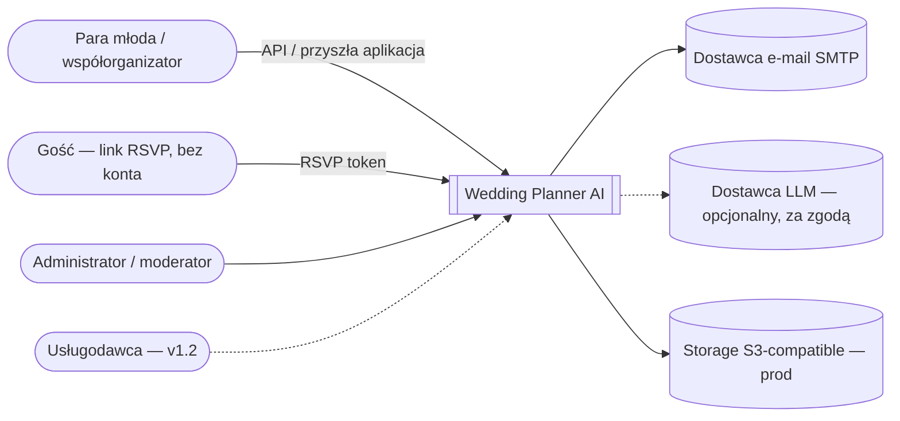
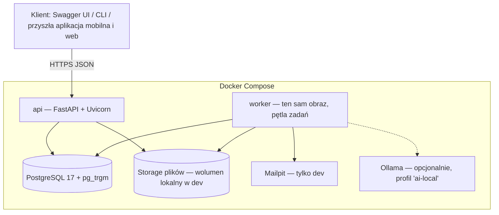
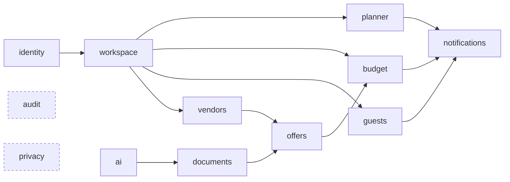
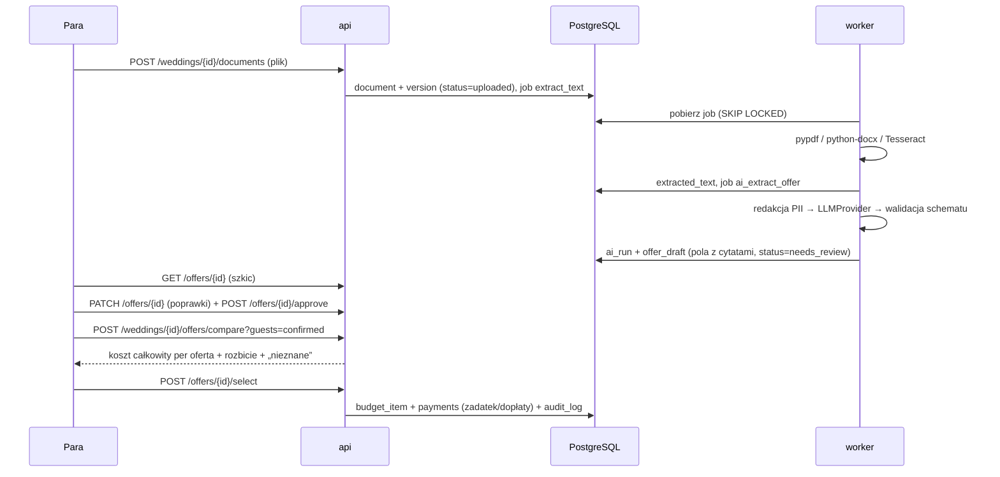
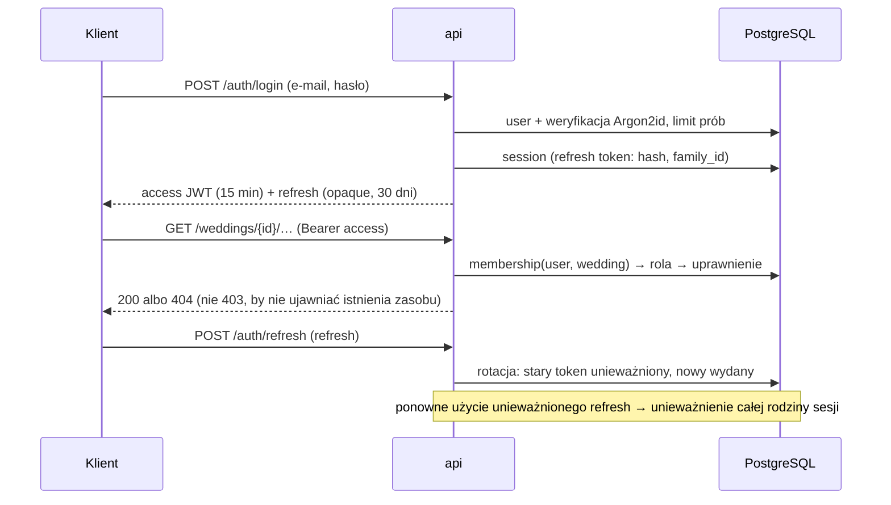

# Architektura: Wedding Planner AI (MVP)

Status: projekt, Etap 1. Decyzje są opisane w [adr/](adr/). Zakres wynika z [analysis/02-iteracje-i-mvp.md](analysis/02-iteracje-i-mvp.md).

## 1. Zasady

- **Modularny monolit**: jedna aplikacja Python/FastAPI, moduły domenowe z jawnymi granicami. Moduły komunikują się przez publiczne serwisy, bez importów z wnętrza innego modułu.
- **API-first, mobile-first**: REST `/api/v1`, OpenAPI generowane z kodu, tokeny Bearer (bez ciasteczek → bez CSRF).
- **PostgreSQL jako jedyne źródło stanu** (dane, kolejka zadań, wyszukiwanie, audyt).
- **Dwa procesy z jednego obrazu**: `api` (HTTP) i `worker` (zadania w tle: ekstrakcja, OCR, LLM, przypomnienia, retencja).
- **Deterministycznie, gdzie się da; LLM tylko do ekstrakcji z dokumentów** i zawsze z zatwierdzeniem przez człowieka.
- **Prywatność domyślnie**: brak wysyłki danych na zewnątrz bez zgody i konfiguracji.

## 2. Diagram kontekstowy



## 3. Diagram kontenerów



W produkcji `files` zastępuje S3-compatible storage u dostawcy w UE, `mailpit` zastępuje SMTP dostawcy, a `ollama` jest wyłączona albo zastąpiona dostawcą zewnętrznym po spełnieniu warunków z ADR-0005.

## 4. Moduły



`audit` i `privacy` są przekrojowe i używane przez wszystkie moduły.

Struktura katalogów:

```
app/
  core/          config, logging, db (engine, sesje), błędy, security (hasła, tokeny), pagination, idempotency
  modules/
    identity/    models.py  schemas.py  service.py  router.py  repository.py
    workspace/   …
    planner/  budget/  guests/  vendors/  offers/  documents/  ai/  notifications/  audit/  privacy/
  jobs/          kolejka (tabela jobs), rejestr handlerów, worker
  main.py        składanie aplikacji (routery, middleware)
migrations/      Alembic
tests/           unit/  integration/  api/  contract/  ai_regression/
```

Każdy moduł ma te same warstwy: `router` (HTTP, walidacja Pydantic) → `service` (logika, uprawnienia, audyt) → `repository` (SQLAlchemy, **zawsze filtrowane po `wedding_id`**).

## 5. Przepływ danych: oferta → porównanie → budżet



## 6. Uwierzytelnianie i autoryzacja



Model uprawnień:

- **Rola globalna** (`user`, `moderator`, `admin`) ustawiana tylko przez administratora.
- **Rola w weselu** (`owner`, `coorganizer`, `viewer`) w tabeli `wedding_members`. Uprawnienia to mapa rola → zbiór akcji (`budget:write`, `guests:read`…) w kodzie, testowana.
- **Gość**: brak konta; token RSVP (losowy, hash w bazie, zakres = jedno gospodarstwo, wygasa po terminie RSVP).
- **Agenci systemowi**: nie są użytkownikami. Działają jako `service principal` w `worker`, z jawną listą dozwolonych akcji per typ zadania (np. `ai_extract_offer` może tylko czytać `document_version` i zapisywać `offer_draft`/`ai_run`). Każda akcja jest audytowana z `actor_type=system`.

## 7. Przetwarzanie dokumentów

```mermaid
flowchart TD
    up[Upload] --> v{Walidacja: rozmiar ≤ 20 MB,\nsygnatura pliku, typ z listy}
    v -- błąd --> rej[422 + powód]
    v -- ok --> store[Zapis: storage/{wedding}/{uuid}, sha256]
    store --> dedup{sha256 już w weselu?}
    dedup -- tak --> link[Nowa wersja wskazuje istniejący plik]
    dedup -- nie --> job1[job: extract_text]
    job1 --> t{Typ}
    t -- PDF z tekstem --> pypdf
    t -- PDF skan / obraz --> ocr[pypdfium2 render → Tesseract pol]
    t -- DOCX --> docx[python-docx]
    pypdf & ocr & docx --> txt[Tekst ze stronami i offsetami]
    txt --> c{Analiza AI włączona\ni w limicie?}
    c -- nie --> manual[Ręczne uzupełnienie oferty]
    c -- tak --> cache{Cache: sha256 + prompt_version + model}
    cache -- trafienie --> draft
    cache -- brak --> red[Redakcja PII] --> llm[LLMProvider] --> val[Walidacja schematu + cytaty]
    val --> draft[offer_draft: needs_review]
```

## 8. Działanie agenta (jedynego w MVP)

```mermaid
flowchart LR
    job[job ai_extract_offer] --> pol{Polityka:\nlimit kosztu/czasu/planu,\nzgoda na dostawcę}
    pol -- odmowa --> esc[status=blocked, powód, powiadomienie]
    pol -- ok --> run[ai_run: model, prompt_version, input_hash]
    run --> call[LLM: tylko JSON wg schematu,\nbez narzędzi, timeout 60 s]
    call --> chk{Schemat OK\ni cytaty istnieją w tekście?}
    chk -- nie, retry ≤ 1 --> call
    chk -- nie --> fail[status=failed → ręczne uzupełnienie]
    chk -- tak --> out[offer_draft + pola unverified]
    out --> human[Zatwierdzenie przez parę]
```

Mechanizmy obowiązkowe: wersjonowany prompt w tabeli `prompt_versions`, limity (tokeny, koszt, czas, liczba uruchomień per wesele/plan), wyłącznik globalny (`AI_ENABLED`) i per typ zadania, log tokenów i kosztu, testy regresji na syntetycznych dokumentach.

## 9. Wdrożenie

```mermaid
flowchart TB
    subgraph laptop[Laptop — development]
        dc[Docker Desktop: api, worker, postgres, mailpit, ollama?]
    end
    subgraph nas[Synology DS225+ — LAN]
        bk[(Kopie pg_dump + pliki)]
        stg[Staging (opcjonalnie, później): api + worker + postgres]
    end
    subgraph prod[Produkcja — VPS w UE, później]
        rp[Reverse proxy TLS — Caddy]
        papi[api] --> pdb[(PostgreSQL)]
        pworker[worker] --> pdb
        rp --> papi
        s3[(S3-compatible UE)]
        off[(Backup off-site szyfrowany)]
    end
    dc -- pg_dump nocny --> bk
    pdb -- backup szyfrowany --> off
```

Dostęp do NAS z zewnątrz wyłącznie przez VPN. Port PostgreSQL nigdy nie jest wystawiony publicznie.

## 10. Przekrojowe

- **Logowanie**: JSON (structlog), `request_id`, `user_id`, `wedding_id`; **bez treści dokumentów, haseł, tokenów i danych gości**.
- **Błędy**: format RFC 9457 (`application/problem+json`) z `code` stabilnym dla klientów.
- **Pieniądze**: `NUMERIC(12,2)` w bazie, `Decimal` w Pythonie, kwoty w API jako **string** (`"1234.50"`) + `currency` (ISO 4217, MVP: `PLN`).
- **Czas**: `timestamptz` w UTC; daty wydarzeń jako `date` + strefa `Europe/Warsaw` w ustawieniach wesela.
- **Identyfikatory**: UUIDv7 (sortowalne, niezgadywalne).
- **Współbieżność**: kolumna `version` + nagłówek `If-Match` / pole `version`, a przy konflikcie `409`.
- **Idempotencja**: nagłówek `Idempotency-Key` dla `POST`, przechowywany 24 h.
- **Health**: `/health/live`, `/health/ready` (DB + migracje aktualne).
