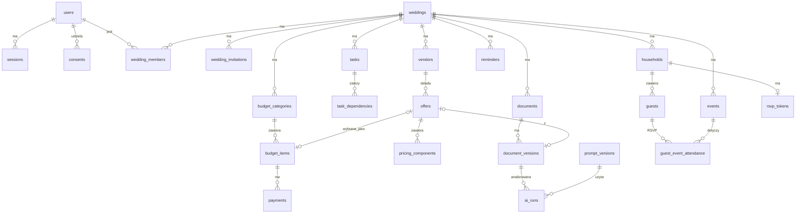

# Model danych (MVP + miejsca na rozszerzenia)

Konwencje dla wszystkich tabel, chyba że zaznaczono inaczej:

- PK: `id UUID` (UUIDv7, generowany w aplikacji).
- Kolumny techniczne: `created_at timestamptz NOT NULL DEFAULT now()`, `updated_at timestamptz NOT NULL`, `version int NOT NULL DEFAULT 1` (optymistyczne blokowanie) w tabelach edytowalnych przez użytkownika.
- Dane wesela: każda tabela domenowa ma `wedding_id` z FK `ON DELETE CASCADE` i **indeks zaczynający się od `wedding_id`**. To podstawa izolacji danych (anty-IDOR).
- Kwoty: `NUMERIC(12,2)` + `currency CHAR(3) NOT NULL DEFAULT 'PLN'` z `CHECK (currency ~ '^[A-Z]{3}$')`.
- Statusy jako `TEXT` z `CHECK (status IN (…))` zamiast typu ENUM w PostgreSQL. Łatwiejsze migracje.
- Audyt: zmiany w tabelach oznaczonych **A** zapisuje warstwa serwisu do `audit_log` (stan przed i po, bez pól wrażliwych).
- Retencja (R) i dane wrażliwe (W) opisane przy tabelach.
- Strategia migracji: Alembic, jedna migracja na zmianę, **każda migracja testowana w CI w obie strony (upgrade → downgrade → upgrade)** na pustej bazie i na seedzie. Zmiany niszczące w dwóch krokach (expand → migrate → contract).

## Diagram ER (rdzeń)

## 1. identity

| Tabela | Kluczowe kolumny | Ograniczenia / indeksy | Uwagi |
|---|---|---|---|
| `users` | `email CITEXT`, `password_hash`, `display_name`, `global_role` (`user`/`moderator`/`admin`), `email_verified_at`, `status` (`active`/`locked`/`pending_deletion`/`deleted`), `locale` | `UNIQUE(email)` | **A**. W: e-mail. R: po usunięciu konta anonimizacja (e-mail → `deleted+{id}@invalid`, nazwa → null) po 30 dniach karencji |
| `sessions` | `user_id FK`, `refresh_token_hash`, `family_id`, `expires_at`, `revoked_at`, `replaced_by`, `user_agent`, `ip_prefix` | `UNIQUE(refresh_token_hash)`, idx `(user_id, revoked_at)` | IP przechowywane jako prefiks /24 (minimalizacja). R: usuwane 30 dni po wygaśnięciu |
| `one_time_tokens` | `user_id FK`, `purpose` (`verify_email`/`reset_password`/`email_change`), `token_hash`, `expires_at`, `used_at` | `UNIQUE(token_hash)` | R: usuwane 7 dni po wygaśnięciu |
| `login_attempts` | `email_hash`, `ip_prefix`, `succeeded`, `at` | idx `(email_hash, at)`, `(ip_prefix, at)` | R: 30 dni. Do limitów i wykrywania brute force |
| `consents` | `user_id FK`, `type` (`terms`/`privacy`/`ai_external_processing`/`marketing`), `document_version`, `granted_at`, `withdrawn_at` | idx `(user_id, type)` | **append-only** (historia zgód jest dowodem). R: okres przedawnienia roszczeń po usunięciu konta (do ustalenia z prawnikiem) |
| `user_mfa` (v1.1) | `user_id FK`, `secret_encrypted`, `enabled_at` | `UNIQUE(user_id)` | W: sekret szyfrowany |

## 2. workspace

| Tabela | Kluczowe kolumny | Ograniczenia / indeksy | Uwagi |
|---|---|---|---|
| `weddings` | `name`, `wedding_date DATE NULL`, `planned_month DATE NULL`, `ceremony_type` (`civil`/`concordat`/`religious_other`/`humanist`/`undecided`), `city`, `region`, `guest_count_planned int`, `total_budget NUMERIC`, `currency`, `style`, `colors TEXT[]`, `priorities TEXT[]`, `timezone` default `Europe/Warsaw`, `status` (`planning`/`completed`/`archived`/`pending_deletion`) | `CHECK (guest_count_planned >= 0)`, `CHECK (total_budget >= 0)` | **A**. R: powiadomienie po 22 mies. od daty, usunięcie po 24 mies. (konfigurowalne, przedłużalne przez parę) |
| `events` | `wedding_id`, `kind` (`ceremony`/`reception`/`after_party`/`other`), `name`, `starts_at`, `ends_at`, `venue_vendor_id FK NULL`, `address` | `CHECK (ends_at > starts_at)`, idx `(wedding_id, starts_at)` | **A**. Poprawiny jako osobne wydarzenie |
| `wedding_members` | `wedding_id`, `user_id`, `role` (`owner`/`coorganizer`/`viewer`) | `PK(wedding_id, user_id)`, idx `(user_id)`; wesele musi mieć ≥1 `owner` (sprawdzane w serwisie + test) | **A** |
| `wedding_invitations` | `wedding_id`, `email`, `role`, `token_hash`, `invited_by`, `expires_at`, `accepted_at` | `UNIQUE(token_hash)` | R: 30 dni po wygaśnięciu |

## 3. planner

| Tabela | Kluczowe kolumny | Ograniczenia / indeksy | Uwagi |
|---|---|---|---|
| `task_templates` | `code`, `template_version`, `title`, `category`, `ceremony_types TEXT[]`, `offset_days int` (względem daty ślubu, ujemne), `priority` | `UNIQUE(code, template_version)` | dane systemowe, wersjonowane |
| `tasks` | `wedding_id`, `template_code NULL`, `parent_task_id NULL`, `title`, `description`, `category`, `priority` (1–4), `status` (`todo`/`in_progress`/`done`/`skipped`), `due_mode` (`relative`/`absolute`/`none`), `offset_days NULL`, `due_date NULL`, `due_manually_set bool`, `assignee_user_id NULL`, `completed_at`, `source` (`template`/`user`/`ai`) | `CHECK` spójności `due_mode` ↔ pola; idx `(wedding_id, status, due_date)` | **A** (historia zmian statusu). `source=ai` zarezerwowane |
| `task_dependencies` | `task_id`, `depends_on_task_id` | `PK(task_id, depends_on_task_id)`, `CHECK (task_id <> depends_on_task_id)`; cykle wykrywane w serwisie | |

## 4. budget

| Tabela | Kluczowe kolumny | Ograniczenia / indeksy | Uwagi |
|---|---|---|---|
| `budget_categories` | `wedding_id`, `name`, `planned_amount`, `sort_order`, `is_reserve bool` | `UNIQUE(wedding_id, name)` | **A** |
| `budget_items` | `wedding_id`, `category_id`, `vendor_id NULL`, `offer_id NULL`, `name`, `cost_mode` (`fixed`/`per_guest`), `unit_price NULL`, `guest_basis` (`planned`/`invited`/`confirmed`) `NULL`, `planned_amount`, `confirmed_amount NULL`, `actual_amount NULL`, `currency`, `status` (`planned`/`confirmed`/`paid`/`cancelled`) | `CHECK` kwot ≥ 0; idx `(wedding_id, category_id)` | **A**. Kwota dla `per_guest` liczona w serwisie (nie zapisywana dwa razy) |
| `payments` | `wedding_id`, `budget_item_id`, `kind` (`deposit_zadatek`/`advance_zaliczka`/`installment`/`final`/`other`), `amount`, `currency`, `due_date NULL`, `paid_at NULL`, `status` (`scheduled`/`paid`/`overdue`/`refunded`/`cancelled`), `source` (`manual`/`offer`/`contract`), `source_document_version_id NULL`, `recurrence NULL` (RRULE, rzadkie) | idx `(wedding_id, status, due_date)` | **A**. `overdue` ustawia worker. Typ `zadatek`/`zaliczka` jest kluczowy domenowo |

## 5. vendors i offers

| Tabela | Kluczowe kolumny | Ograniczenia / indeksy | Uwagi |
|---|---|---|---|
| `vendors` | `wedding_id`, `name`, `category` (słownik kategorii), `website_url`, `email`, `phone`, `city`, `status` (`considering`/`contacted`/`offer_received`/`booked`/`rejected`), `notes`, `vendor_profile_id NULL` (v1.2) | idx `(wedding_id, category)`, GIN trigram na `name` (wykrywanie duplikatów w weselu) | **A**. Dane kontaktowe firm, często jednoosobowych działalności (dane osobowe). R: z weselem |
| `offers` | `wedding_id`, `vendor_id`, `title`, `valid_until NULL`, `min_guests NULL`, `child_price_ratio NUMERIC(4,3) NULL`, `currency`, `status` (`draft`/`needs_review`/`approved`/`selected`/`rejected`), `source` (`manual`/`ai_extraction`/`vendor_structured`), `source_document_version_id NULL`, `ai_run_id NULL`, `approved_by`, `approved_at` | idx `(wedding_id, vendor_id)`; tylko jedna `selected` per (wedding, kategoria vendora) w serwisie | **A**. Ofert **nie agregujemy między weselami** (ADR/analiza Iteracja 4) |
| `pricing_components` | `offer_id`, `label`, `kind` (`per_guest`/`per_child`/`fixed`/`per_hour`/`per_unit`/`percent`), `amount`, `quantity NULL`, `included bool`, `optional bool`, `event_kind NULL` (np. poprawiny), `citation JSONB NULL` (`{page, start, end, quote}`), `confidence` (`high`/`medium`/`low`/`unverified`) | idx `(offer_id)` | Podstawa porównania kosztu całkowitego |
| `offer_terms` | `offer_id`, `term_type` (`deposit`/`payment_schedule`/`cancellation`/`menu`/`drinks`/`corkage`/`overtime`/`other`), `value JSONB`, `citation JSONB`, `confidence` | idx `(offer_id, term_type)` | Fakty z umowy, bez oceny prawnej |
| `vendor_profiles` (v1.2) | `name`, `nip`, `category`, `regions`, `source` (`vendor`/`admin`/`user_report`), `legal_basis`, `acquired_at`, `verified_at`, `verification_status`, `trust_level` | `UNIQUE(nip)` gdy nie null; GIN trigram na nazwie | Publiczny katalog, tylko dane od firm. Historia zmian + `data_requests` |

## 6. documents

| Tabela | Kluczowe kolumny | Ograniczenia / indeksy | Uwagi |
|---|---|---|---|
| `documents` | `wedding_id`, `kind` (`offer`/`contract`/`invoice`/`payment_proof`/`other`), `title`, `vendor_id NULL`, `current_version_id NULL` | idx `(wedding_id, kind)` | **A** |
| `document_versions` | `document_id`, `wedding_id`, `version_no`, `storage_key`, `sha256`, `mime_type`, `size_bytes`, `original_filename_sanitized`, `uploaded_by`, `text_status` (`pending`/`done`/`failed`/`not_applicable`), `extracted_text TEXT NULL`, `page_offsets JSONB NULL`, `ocr_used bool`, `text_error` | `UNIQUE(document_id, version_no)`, idx `(wedding_id, sha256)` | W: **treść umów (PESEL, adresy, konta)**. Tekst w bazie, plik w storage, szyfrowanie storage w spoczynku. R: z weselem |

## 7. guests

| Tabela | Kluczowe kolumny | Ograniczenia / indeksy | Uwagi |
|---|---|---|---|
| `households` | `wedding_id`, `name` („Państwo Kowalscy”), `side` (`bride`/`groom`/`both`/`other`), `group_label`, `contact_email NULL`, `contact_phone NULL`, `invitation_status` (`not_sent`/`sent`/`delivered`), `rsvp_deadline NULL`, `notes` | idx `(wedding_id)` | **A**. W: kontakt. R: anonimizacja 90 dni po ostatnim wydarzeniu |
| `guests` | `wedding_id`, `household_id`, `first_name`, `last_name NULL`, `age_group` (`adult`/`teen`/`child`/`infant`), `is_plus_one bool`, `plus_one_of NULL`, `dietary_preference` (enum), `dietary_note_encrypted BYTEA NULL`, `needs_accommodation bool`, `needs_transport bool`, `notes` | idx `(wedding_id, household_id)` | **W: `dietary_note` może zawierać dane o zdrowiu**, więc szyfrowanie kolumnowe (klucz z env/KMS), brak w logach i eksportach CSV bez potwierdzenia. R: 90 dni po wydarzeniu → anonimizacja (imię → „Gość N”, notatki → null) |
| `guest_event_attendance` | `guest_id`, `event_id`, `status` (`pending`/`attending`/`declined`/`maybe`), `responded_at`, `responded_via` (`couple`/`rsvp_link`) | `PK(guest_id, event_id)` | **A** |
| `rsvp_tokens` | `household_id`, `token_hash`, `expires_at`, `revoked_at`, `last_used_at` | `UNIQUE(token_hash)`, `UNIQUE(household_id) WHERE revoked_at IS NULL` | Gość widzi i edytuje **tylko swoje gospodarstwo** |
| `venues`, `tables`, `seats`, `seating_rules` (v1.1) | sala → stoły (kształt, liczba miejsc) → miejsca; reguły `together`/`apart`/`near_head_table` z wagą | | Solver OR-Tools, ręczne przypisania mają priorytet |
| `day_schedule_items` (v1.1) | `event_id`, `starts_at`, `duration`, `location`, `responsible`, `vendor_id`, `buffer_minutes`, `depends_on` | | Konflikty liczone w kodzie |

## 8. ai, jobs, notifications

| Tabela | Kluczowe kolumny | Ograniczenia / indeksy | Uwagi |
|---|---|---|---|
| `prompt_versions` | `name`, `version`, `template`, `output_schema JSONB`, `model_constraints`, `created_at`, `retired_at` | `UNIQUE(name, version)` | Niezmienne po utworzeniu |
| `ai_runs` | `wedding_id`, `job_id`, `task_type`, `provider`, `model`, `model_license`, `prompt_version_id`, `input_hash`, `document_version_id NULL`, `status` (`queued`/`running`/`succeeded`/`failed`/`blocked`), `output JSONB`, `validation_errors JSONB`, `tokens_in`, `tokens_out`, `cost NUMERIC(10,4)`, `duration_ms`, `external_processing bool`, `consent_id NULL` | idx `(wedding_id, created_at)`, idx `(input_hash, prompt_version_id, model)` (cache) | Audytowalność AI. R: z weselem; zagregowane metryki bez treści dłużej |
| `jobs` | `type`, `payload JSONB`, `status` (`queued`/`running`/`succeeded`/`failed`/`dead`), `attempts`, `max_attempts`, `run_after`, `locked_until`, `last_error`, `wedding_id NULL` | idx częściowy `(run_after) WHERE status='queued'` | Payload bez danych wrażliwych (tylko identyfikatory). R: 30 dni po zakończeniu |
| `reminders` | `wedding_id`, `user_id`, `target_type` (`task`/`payment`/`rsvp_deadline`), `target_id`, `remind_at`, `channel` (`email`), `sent_at`, `status` | idx `(status, remind_at)` | |
| `notification_preferences` | `user_id`, `digest` (`daily`/`weekly`/`off`), `quiet_hours` | `PK(user_id)` | |

## 9. audit, privacy, moderacja

| Tabela | Kluczowe kolumny | Uwagi |
|---|---|---|
| `audit_log` | `occurred_at`, `actor_type` (`user`/`system`/`guest`/`admin`), `actor_id`, `wedding_id NULL`, `entity_type`, `entity_id`, `action`, `changes JSONB` (bez pól W), `request_id`, `ip_prefix` | **append-only** (uprawnienia DB: `INSERT` only dla roli aplikacji). Indeks `(wedding_id, occurred_at)`, `(entity_type, entity_id)`. R: 24 mies.; przy usunięciu wesela pseudonimizacja `actor_id` |
| `security_events` | `occurred_at`, `type` (`login_failed`/`token_reuse`/`password_reset`/`rate_limited`/…), `user_id NULL`, `ip_prefix`, `details` | R: 12 mies. |
| `data_requests` | `requester_user_id NULL`, `requester_email`, `type` (`export`/`deletion`/`rectification`/`catalog_removal`), `status` (`received`/`in_progress`/`completed`/`rejected`), `due_at` (30 dni, art. 12 RODO), `completed_at`, `result_storage_key NULL` | Eksport: ZIP (JSON + pliki), link ważny 7 dni |
| `error_reports` | `reporter_user_id`, `entity_type`, `entity_id`, `description`, `status` | Zgłoszenia błędnych danych (np. katalog v1.2, wynik AI) |

## 10. Dane wrażliwe: podsumowanie

| Dane | Gdzie | Ochrona |
|---|---|---|
| Hasła | `users.password_hash` | Argon2id, nigdy w logach |
| Tokeny | `sessions`, `one_time_tokens`, `rsvp_tokens`, `wedding_invitations` | tylko hash SHA-256 |
| Uwagi dietetyczne (możliwe dane o zdrowiu) | `guests.dietary_note_encrypted` | szyfrowanie kolumnowe (AES-GCM, `cryptography`, Apache/BSD), minimalizacja, krótka retencja |
| Treść umów | `document_versions.extracted_text` + storage | dostęp tylko członków wesela, szyfrowanie dysku/storage, redakcja PII przed zewnętrznym LLM |
| Kontakty gości i firm | `households`, `vendors` | dostęp per wesele, retencja |

## Tabele dodane 2026-10-22

| Tabela | Kluczowe kolumny | Uwagi |
|---|---|---|
| `reserve_entries` | `wedding_id`, `name`, `side`, `persons` (1–20), `position`, `status` (`waiting`/`invited`), `household_id NULL` | lista rezerwowa; usuwana z anonimizacją gości |
| `vendor_briefs` | `vendor_id` PK, `must`/`avoid`/`people` JSONB, `notes`, `contact`, `content_hash`, `content_version`, `ack_*`, `version` | informacje dla usługodawcy i wersje programu; `people`/`contact` czyszczone po weselu |
| `funders`, `funder_contributions` | `name`, `side`, `pledged_amount`; wpłaty: `amount`, `received_on`, `status` (`confirmed`/`reported`) | portfel sponsorów; `funder_id` w `payments`, `wedding_members`, `wedding_invitations`; rola `sponsor` |
| `ceremony_documents` | PK `(wedding_id, code)`, `issued_on`, `done`, `valid_months` | stan licznika dokumentów; zasady w kodzie |
| `budget_items` (nowe kolumny) | `indexation` (`none`/`cpi`/`price_list`/`cap`), `indexation_cap_percent`, `price_fixed_on`, `price_review_on` | strażnik waloryzacji |
| `households` (nowe kolumny) | `delivery_method`, `delivery_by`, `delivery_place`, `delivery_planned_on`, `delivered_on` | wręczanie zaproszeń; miejscowość i wręczający czyszczeni po weselu |
| `transport_runs`, `transport_seats` | kurs: `name`, `kind`, `departs_at`, `from/to_place`, `capacity`, `vendor_id`, `show_to_guests`; miejsca: PK `(run_id, guest_id)` | moduł `logistics` |
| `lodging_rooms`, `room_guests` | pokój: `place`, `name`, `beds`, `check_in/out`, `paid_by`; gość: PK `guest_id` | jeden pokój na gościa |
| `deliverables`, `after_checks` | `title`, `vendor_id`, `due_on`, `received_on`; PK `(wedding_id, code)`, `done_on` | moduł `aftercare` (po weselu) |

## Tabele dodane 2026-10-22 (analiza 07)

| Tabela | Kluczowe kolumny | Uwagi |
|---|---|---|
| `music_entries` | `moment` (ceremonia… „nie grać”), `title`, `artist`, `note`, `status` (`approved`/`suggested`/`rejected`), `household_id NULL` | muzyka; zatwierdzone trafiają do linku DJ-a/zespołu/muzyka (nowa wersja programu) |
| `photo_groups`, `photo_group_guests` | grupa: `title`, `extra`, `minutes` (1–60), `done`, `position`; osoby: PK `(group_id, guest_id)` | zdjęcia grupowe; fotograf widzi imię i inicjał nazwiska |
| `prep_plans`, `prep_people` | plan: PK `wedding_id`, `ready_by`, `hair_artists`, `makeup_artists`; osoby: `name`, `hair_minutes`, `makeup_minutes`, `position` | plan przygotowań liczony wstecz (bez zapisu wyniku) |
| `menu_dishes` | `course`, `name`, `description`, `allergens` (14 z rozp. UE 1169/2011), `vegetarian`, `vegan` | menu; wegańskie ⇒ wegetariańskie (ograniczenie w bazie) |
| `guest_wishes` | `author`, `text` (≤ 1000), `hidden`, `household_id NULL` | księga życzeń; zostaje po usunięciu zaproszenia |
| `helpers` | `name`, `token_hash` (unikalny), `last_used_at`; `tasks.helper_id` | pomocnicy bez konta; w eksporcie bez hasha tokenu |
| `guest_info` (nowe kolumny) | `song_requests`, `show_menu`, `show_tables`, `wishes_enabled`, `announcement`, `announcement_at`, `announcement_emailed_at` | przełączniki strony gościa i komunikat |

## Tabele dodane 2026-10-22 (analiza 08)

| Tabela | Kluczowe kolumny | Uwagi |
|---|---|---|
| `gift_ideas` | `kind` (`item`/`fund`), `title`, `note`, `link` (http/https), `reserved_by` (rodzina, SET NULL), `reserved_at`, `position`, `version` | fundusz nie może być zarezerwowany (ograniczenie w bazie) |
| `task_comments` | `task_id` (CASCADE), `author_user_id` (SET NULL), `text` (≤ 1000), `created_at` | komentarze przy zadaniach |
| `guest_info` (nowa kolumna) | `gifts_enabled` | lista prezentów na stronie gościa |
